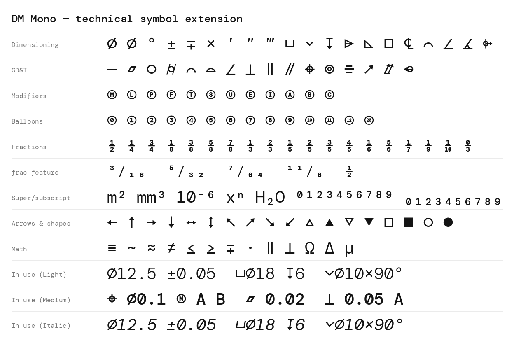

# DM Mono

DM Mono is a 3 weight, 3 style family designed for DeepMind.
DM Mono was loosely based off of DM Sans, with a reduction in contrast and less geometric proportions.

The type design and font development was commissioned from [Colophon Foundry](https://www.colophon-foundry.org), with Creative Direction from the DeepMind team.

These fonts are not officially supported Google products.

## License

All fonts are licensed under the [SIL Open Font License](https://scripts.sil.org/ofl).

## Technical symbol extension (v1.100)

This fork extends DM Mono with characters used on technical drawings, in
engineering notes and in GD&T feature control frames. All six styles are
covered, every glyph keeps the 600-unit monospaced width, and the new
outlines are drawn from the existing font's stroke weights so they sit
alongside the original glyphs.



**Dimensioning:** ⌀ ∅ ′ ″ ‴ ∓ ⌴ ⌵ ↧ ⌲ ⌳ □ ℄ ⌒ ∡ ⌱ (° ± × were already present)

**GD&T (ASME Y14.5 / ISO 1101):** ⏤ straightness, ⏥ flatness,
○ circularity, ⌭ cylindricity, ⌒ profile of a line, ⌓ profile of a surface,
∠ angularity, ⟂ ⊥ perpendicularity, ∥ ⫽ parallelism, ⌖ position,
◎ concentricity, ⌯ symmetry, ↗ circular runout, ⌰ total runout,
⌮ all-around profile, plus circled modifiers Ⓐ–Ⓩ (Ⓜ Ⓛ Ⓟ Ⓕ Ⓣ Ⓢ Ⓤ …)

**Balloons:** ⓪ ①–⑳

**Fractions:** ⅐ ⅑ ⅒ ⅓ ⅔ ⅕ ⅖ ⅗ ⅘ ⅙ ⅚ ⅛ ⅜ ⅝ ⅞ ↉ ⅟ in the same stacked
style as the original ½ ¼ ¾

**Superscripts & subscripts:** ⁰–⁹ ⁺ ⁻ ⁼ ⁽ ⁾ ⁿ and ₀–₉ ₊ ₋ ₌ ₍ ₎

**Arrows & shapes:** ← ↑ → ↓ ↔ ↕ ↖ ↗ ↘ ↙ △ ▲ ▽ ▼ □ ■ ○ ●

**Math & aliases:** ≡ ∼ ⋅ ∙ Ω Δ μ ‐ ‑ ‒ ― and figure/thin/narrow
no-break spaces

### OpenType features

* `frac`: any fraction (`3/16`, `5/64`, `11/8`) becomes numerator, fraction
  slash and denominator figures. `1/2`, `1/8`, `2/3` and the other
  single-figure fractions turn into the stacked one-cell glyph, as before.
  Dates such as `12/31/2020` are left alone.
* `numr`, `dnom`: numerator and denominator figures.
* `sups`, `subs`, `sinf`: superior and inferior figures, `+ - = ( )`.

### Variable fonts

`exports/variable/` holds two variable fonts, `DMMono[wght].ttf` and
`DMMono-Italic[wght].ttf`, with a weight axis from 300 (Light) through 400
(Regular, the default) to 500 (Medium). The range is set by the two
masters each source has; a wider range would need new Thin or Bold masters.
Named instances and the STAT table match the static fonts, so apps pair the
upright and italic files as one family.

### Building

The new glyphs are generated into the Glyphs sources by
`tools/extend/build.py` (see `tools/extend/README.md`). To build the fonts:

```sh
pip install -r requirements.txt
cd source && sh build.sh
```
